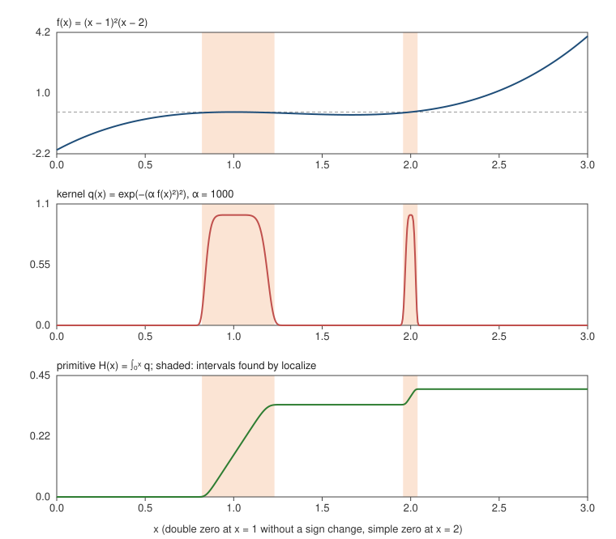

# MassRoots.jl

[](https://github.com/111moses111/MassRoots.jl/actions/workflows/CI.yml)
[](LICENSE)
[](https://julialang.org)
[](paper/Preprint_1.pdf)

**Localization of real zeros of real analytic functions by integral mass tests,
including zeros at which the function does not change sign.**

The method applies to any real-valued analytic function `f` of a real variable. It is
turned into a kernel `q_α(x) = g(α φ(x))` with `φ = f²` (or `φ = f` when `f` is already
nonnegative) and `g(s) = exp(-s²)` or `g(s) = erfc(s)`. The kernel equals 1 at the zeros
of `f`, including zeros where `f` does not change sign, and is small elsewhere. The
difference `H(v) - H(u)` of its primitive `H(x) = ∫_{x₀}^{x} q_α` is the mass of
`[u, v]`; a threshold on the mass tells whether the interval contains a zero, and
bisection locates it. Only values of one real primitive are used, and the kernel has no
poles: unlike `f'/f` or `1/f` in argument-principle methods, `g(α φ)` is analytic
wherever `f` is.

The method is introduced in *M. Plistiev, "On Some Connections Between Computation of
Integrals of Analytic Functions, Root Finding, Integer Factorization and
NP-Completeness"* (preprint, 2026, [PDF](paper/Preprint_1.pdf)), where it is also used to prove polynomial-time
reductions from integer factorization and an NP-complete Diophantine problem to the
evaluation of `H` (see [Certified applications](#certified-applications-from-the-paper)).

**Contents:** [Installation](#installation) ·
[Quick start](#quick-start-a-zero-without-a-sign-change) ·
[Certified applications](#certified-applications-from-the-paper) ·
[Evaluators of H](#interchangeable-evaluators-of-h) ·
[Your own problem](#your-own-problem) · [Guarantees](#guarantees) ·
[What it costs](#what-it-costs) · [Reproducing the results](#reproducing-the-results) ·
[Citing](#citing)

## Installation

```julia
pkg> add https://github.com/111moses111/MassRoots.jl
pkg> add Arblib        # optional: the rigorous evaluator
```

Julia 1.11 or newer.

## Quick start: a zero without a sign change

```julia
using MassRoots

f(x) = (x - 1)^2 * (x - 2)       # double zero at x = 1, simple zero at x = 2
prob = GeneralProblem(f, 0, 3)   # φ = f²

ivals, oracle = localize(prob, QuadGKEvaluator(Float64; segment_length = 1//64);
                         α = 1000, threshold = 1e-3, resolution = 1//64)
# ivals ≈ [(0.820, 1.230), (1.957, 2.039)];  nqueries(oracle) == 57
```

`f` does not change sign at `x = 1` (`f(0.9) ≈ -0.011`, `f(1.1) ≈ -0.009`), so methods
that bracket a sign change cannot see this zero; the mass test finds both. The interval
around the double zero is wider because `f²` is flatter there; a larger `α` narrows it.



*Top: `f`. Middle: the kernel `q = exp(-(α f²)²)` with `α = 1000`. Bottom: the primitive
`H`; its two steps are the zeros. Shaded: the intervals returned by `localize`. Produced by
`examples/readme_figure.jl`.*

For a general `f`, the scale `α`, the threshold and the resolution are chosen by you, and
there is no certified gap: a small positive minimum of `f²` can pass the test, and a peak
narrower than the quadrature can resolve can be missed (see [Guarantees](#guarantees)).
For problems whose zeros are integers the package chooses all parameters itself and the
result is proved, as described next.

## Certified applications from the paper

For problems whose zeros are integers and which have a certified scale `S`
(Theorem 5 of the paper), the choice `α = S²` and an absolute accuracy of
`p = ⌈log₂(32 S ⌈√S⌉)⌉` bits for each value of `H` make every test correct, and a
zero is found with at most `2 + ⌈log₂ M⌉` values of `H` for `M` candidates
(Theorem 6). Divisor search and the NP-complete quadratic problem `a m² + b k = c` are
built in.

```julia
using MassRoots, Arblib

r = find_divisor(1001, ArbEvaluator())     # LocateResult(:found, root = 7, queries = 12)
r.oracle.log                               # every value of H: point, value, error bound, time

factorize(588, ArbEvaluator())             # ([2, 2, 3, 7, 7], 44)

Q = QuadraticProblem(3, 7, 103)            # 3m² + 7k = 103
decide(Q, ArbEvaluator())                  # (true, …) – exactly two values of H
locate(Q, ArbEvaluator()).root             # 2

# H itself
H = HFunction(FactorProblem(91))           # certified α, Gaussian kernel
atol = mass_test_parameters(FactorProblem(91)).atol
evaluate(ArbEvaluator(), H, 89//2, atol)   # HValue: value, error bound, diagnostics
```

More in [`examples/`](examples); see [Reproducing the results](#reproducing-the-results).

## Interchangeable evaluators of H

**The package is built around one idea: the way `H` is computed is interchangeable.**
Problems, kernels and the search logic are fixed; an *evaluator* decides how `H(x)` is
computed. Every value of `H` goes through an `Oracle` that counts, times and logs it, so
different approaches can be compared on equal terms.

### Building blocks

| Part | Types |
|---|---|
| Problems | `GeneralProblem(f, a, b)` for any real analytic `f` with arbitrary zeros, `IntegerZeroProblem(φ, candidates, S; isroot)` for your own problem with integer zeros, `FactorProblem(t)`, `QuadraticProblem(a, b, c)` |
| Kernels | `GaussKernel()` (`exp(-s²)`), `ErfcKernel()`; optional modulation `ShiftedPower(β, ρ)` (§2.3; its certified parameters extend Theorem 5 and are not in the current text of the paper) |
| Parameters | `mass_test_parameters(problem)`: `S`, `α = S²`, `w`, threshold `θ = 3w/4`, `p`, `atol = 2⁻ᵖ`, all exact |
| Evaluators | see below; any subtype of `AbstractEvaluator` |
| Search | `localize` (any problem), `locate`, `decide`, `find_divisor`, `factorize` (certified problems) |

### Evaluators

| Evaluator | Number types | Rigorous | Notes |
|---|---|---|---|
| `QuadGKEvaluator(T)` | `Float64`, `BigFloat`, `Double64`, … | no | adaptive Gauss–Kronrod on a uniform pre-subdivision |
| `GaussLegendreEvaluator(T)` | same | no | fixed composite rule; cost known in advance |
| `ArbEvaluator()` | Arb balls (needs `using Arblib`) | yes | `acb_calc_integrate`; returns an enclosure of `H(x)` and tightens itself until the enclosure is within `atol` |
| `IdealEvaluator()` | — | — | **test oracle that knows the zeros**; checks the search logic and query counts, never a solver |

For `BigFloat` and Arb the working precision is chosen from the requested accuracy, the
size of `α`, the length of the interval and the size of the arguments of `φ`
(`MassRoots.required_precision`), so the input size is not limited. Override it with
the `precision` keyword.

The default pre-subdivision of the quadrature evaluators for certified problems has step
`2w = 1/(S⌈√S⌉)`. By the proof of Theorem 5 the kernel is at least 1/2 within `w` of
every zero, so no peak can fall between the nodes; the price is about `t⁴` segments for
divisor search. Without a pre-subdivision (`segment_length = nothing`) an adaptive rule
can step over a narrow peak and report no zero. For a general problem choose
`segment_length` below the expected peak width.

### Writing your own evaluator

```julia
struct MyEvaluator <: AbstractEvaluator end

function MassRoots.evaluate(ev::MyEvaluator, H::HFunction, x::Rational{BigInt},
                            atol::Rational{BigInt})
    # compute H(x) = ∫_{H.x0}^{x} integrand(H, ξ) dξ to absolute accuracy atol
    return HValue(value, error_bound; rigorous = false, info = (evals = n,))
end

find_divisor(1001, MyEvaluator())
```

`integrand(H, ξ)` works for any number type of `ξ`, real or complex. An evaluator may
also dispatch on the problem, e.g. `evaluate(::MyEvaluator, H::HFunction{FactorProblem}, x, atol)`,
to use the structure of `f_t`. See `examples/custom_evaluator.jl`.

## Your own problem

**Any real analytic function.** `GeneralProblem(f, a, b)` uses `φ = f²`; pass
`square = false` to use `φ = f` when `f ≥ 0`. Run `localize` with `α`, the threshold and
the resolution chosen by you (see the quick start and `examples/general_function.jl`).

**Integer zeros with a certified scale.** With a scale `S` satisfying the three
hypotheses of Theorem 5 on `I* = [first - 1/2, last + 1/2]` — `|I*| ≤ S`; `φ ≥ 1/S` on
candidate blocks without zeros; `φ(d + s) ≤ S s²` near every zero `d` for `|s| ≤ 1/2` —
the guarantees carry over:

```julia
prob = IntegerZeroProblem(φ, lo:hi, S; isroot = m -> exact_check(m))
locate(prob, ArbEvaluator())
```

In both cases the function must accept the number types of the evaluators you use
(complex balls for `ArbEvaluator`).

## Guarantees

A result is proved only for a certified problem evaluated with a rigorous evaluator: the
`Oracle` rejects any rigorous value whose error bound exceeds `atol`. With a
non-rigorous evaluator the answer can be wrong; the search reports `:inconsistent`
(a positive block with two negative halves) or `:unverified` (the final candidate fails
the exact check) when it notices. For a `GeneralProblem`, `localize` returns the
intervals whose computed mass exceeds the threshold; whether they contain zeros depends
on the parameters you chose.

## What it costs

The number of values of `H` grows like `log t`, but the cost of one value grows with
`t`: the integration interval has length about `t` and the peaks are narrower than
`t⁻²`. Divisor search on a 2-core machine (`examples/compare_evaluators.jl`; times
include all queries):

| t | queries | QuadGK Float64 | Gauss–Legendre Float64 | Arb, Gaussian kernel | Arb, erfc kernel |
|---|---|---|---|---|---|
| 21 = 3·7 | 7 | 13 s | 14 s | 0.06 s | 0.03 s |
| 91 = 7·13 | 8 | — | — | 0.3 s | 0.09 s |
| 323 = 17·19 | 10 | — | — | 1.5 s | 0.23 s |
| 1001 = 7·11·13 | 12 | — | — | 5.2 s | 1.7 s |
| 2021 = 43·47 | 13 | — | — | 11.9 s | 3.0 s |

The rigorous Arb integration is far cheaper here than the safe uniform subdivision,
and its time grows roughly linearly in `t`, i.e. exponentially in the bit length.

For larger semiprimes `t = p·q` with prime factors of similar size
(`examples/timing_semiprimes.jl`; Arb, erfc kernel, 2-core machine):

| t | digits | factors | queries | total time | longest query |
|---|---|---|---|---|---|
| 1 147 | 4 | 31·37 | 12 | 1.2 s | 0.3 s |
| 10 403 | 5 | 101·103 | 16 | 11.7 s | 2.1 s |
| 104 927 | 6 | 317·331 | 19 | 3 min 14 s | 30 s |
| 1 022 117 | 7 | 1009·1013 | 22 | 45 min | 3 min 51 s |

The number of queries follows `2 + ⌈log₂ M⌉` (Theorem 6), while the time grows roughly
like `t^1.15`. How the cost of computing `H` depends on the input is the open question of
§6 of the paper, and the evaluator interface exists to study it.

## Reproducing the results

All examples run with `julia --project=examples examples/<file>.jl`.

| File | What it shows |
|---|---|
| `double_zero.jl` | the quick start: a double zero without a sign change and a simple zero |
| `general_function.jl` | example (2.6) of the paper, `f(x) = sin(πx/2) + sin²(4πx) + 0.1` |
| `readme_figure.jl` | regenerates the figure above (`docs/assets/double_zero.svg`) |
| `quickstart.jl` | divisor search, factorization and the quadratic problem with certified parameters |
| `custom_evaluator.jl` | how to plug in your own way of computing `H` |
| `compare_evaluators.jl` | the first timing table above |
| `timing_semiprimes.jl` | the second timing table above (the case `t ≈ 10⁶` is commented out) |

## Tests

```julia
pkg> test MassRoots
```

## Citing

If you use this package, please cite the accompanying paper:

```bibtex
@unpublished{Plistiev2026,
  author = {Moisej Plistiev},
  title  = {On Some Connections Between Computation of Integrals of Analytic Functions,
            Root Finding, Integer Factorization and NP-Completeness},
  note   = {Preprint},
  url    = {https://github.com/111moses111/MassRoots.jl/blob/main/paper/Preprint_1.pdf},
  year   = {2026}
}
```

Citation metadata for the software itself is in [`CITATION.cff`](CITATION.cff); GitHub
shows it under "Cite this repository".

## License

MIT
